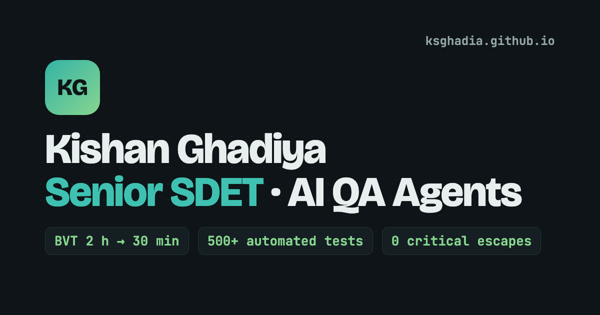

# Kishan Ghadiya · Senior SDET portfolio

**Live site:** https://ksghadia.github.io

[](https://ksghadia.github.io)

A one-page portfolio you can ask questions. I'm a Senior SDET who builds AI QA agents and owns release quality for ed-tech products. This site presents that work and lets recruiters and engineers question it directly.

## Features

- **Ask box.** Type a question or tap a topic chip. Answers are prewritten from my CV and picked by keyword matching, and each one shows its source.
- **Honest gaps.** Questions about tools I haven't used (for example Selenium, Java or Docker) get a clear "not on my CV" answer instead of a near match.
- **Recruiter basics.** Download CV, LinkedIn and copy-email buttons in the hero, and a notice-period answer.
- **Sections.** Impact numbers, results at work, projects, experience, skills and contact.
- **Light and dark themes.** Follows the system setting, with a toggle that is remembered per visitor.
- **Link preview.** `og.png` gives a proper card when the link is shared on LinkedIn, WhatsApp or Slack.

## How it works

There is no backend, build step or paid API. Everything is in one static file served by GitHub Pages.

The answers live in a `KB` array inside the `<script>` at the end of `index.html`. Each entry has:

| Field | Purpose |
|---|---|
| `id` | Unique key, also used for the chip's element id |
| `chip` | Label of the topic chip under the ask box |
| `q` | Question shown when the chip is tapped |
| `keys` | Keywords that route a typed question to this answer |
| `a` | Answer HTML |
| `hidden` | Optional. `true` answers typed questions but shows no chip |

A typed question is scored against every entry's `keys`, and the best match wins. Longer keywords count double. If nothing matches, the page says it has no prepared answer and points to email.

## Files

| File | What it is |
|---|---|
| `index.html` | The whole site: markup, styles and script |
| `Kishan_Ghadiya_Senior_SDET.pdf` | Public one-page CV (no phone number) |
| `og.png` | 1200×630 social preview image |

## Run locally

```bash
git clone https://github.com/ksghadia/ksghadia.github.io.git
cd ksghadia.github.io
python3 -m http.server 8000
```

Then open http://localhost:8000.

## Update the site

1. Edit `index.html`. To add an answer, add an entry to the `KB` array.
2. Preview locally (see above) and try a few questions in the ask box.
3. Commit and push to `main`. GitHub Pages republishes in about a minute.

When the CV changes, replace `Kishan_Ghadiya_Senior_SDET.pdf` with the new public version and update any numbers in `index.html` and the `KB` answers so all three stay in sync.

## Privacy

- The site and CV show only my email and LinkedIn, no phone number.
- Work results are described without internal names, repositories, ticket keys or customer data.

## Contact

- Email: ksghadia@gmail.com
- LinkedIn: https://www.linkedin.com/in/kishan-ghadiya/
